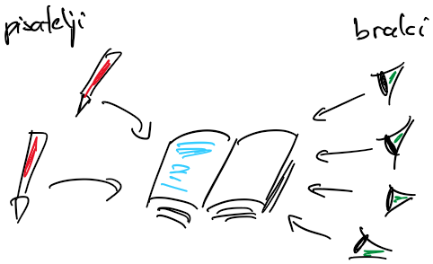

# Sinhronizacija

## Semaforji [LBS:2]

- semafor (*angl.* semaphore) je struktura, podobna ključavnici
- za razliko od ključavnice, ki je binarna (odklenjena ali zaklenjena), je semafor števen, njegova vrednost je pozitivna ali enaka nič
- semafor pozna dve atomarni operaciji:
  - poskusi vstopiti:
    - če je vrednost semaforja 0, gorutina ne more vstopiti in čaka
    - vstop je mogoč, če je vrednost semaforja večja od 0
    - ob vstopu se vrednost semaforja zmanjša za ena
  - sprosti
    - vrednost semaforja se poveča za ena
- katerakoli gorutina lahko spreminja stanje semaforja
  - pri delu s ključavnicami je priporočljivo, da gorutina, ki ključavnico zaklene, ključavnico tudi odklene
  - pri semaforjih in kanalih te omejitve ni
- semaforje lahko uporabimo za sinhronizacijo med nitmi/gorutinami v procesu ali za sinhronizacijo med procesi

## Bralno-pisalne ključavnice [SMAP:9.10]

- bralno-pisalno ključavnico (*angl.* reader-writer lock) lahko zaklenemo in odklenemo za branje ali za pisanje
- če jo zaklenemo za branje, lahko vstopi več gorutin z željo po branju, ne morejo pa vstopiti gorutine za pisanje
  - mnogo gorutin želi hkrati brati skupno spremenljivko
- če jo zaklenemo za pisanje, ne more vstopiti nobena druga gorutina
  - nobena gorutina ne sme dostopati do skupne spremenljivke, medtem ko ena gorutina vanjo piše
- jezik go preprečuje stradanje pisateljev in bralcev
  - izmenično določanje prednosti pri pridobivanju ključavnice
  - vzemimo, da na vstop v kritični odsek čaka več pisateljev in bralcev
    - ko ključavnico sprosti zadnji bralec, bo naslednji ključavnico dobil pisatelj
    - ko ključavnico sprosti pisatelj, jo dobijo čakajoči bralci
- v knjižnici glibc za jezik C imajo privzeto bralci prednost, zato pisatelji lahko stradajo
- primer uporabe:
  - branje in pisanje datotek
  - metodi *get* in *set* pri dostopanju do lastnosti objektov

- primer: pisatelji in bralci [LBS:4.2]

  

  - imamo več pisateljev, ki pišejo knjigo, in več bralcev, ki knjigo berejo
  - pisatelji ne smejo pisati med branjem in bralci ne smejo brati med pisanjem
  - piše lahko samo en pisatelj naenkrat
  - bere lahko več bralcev hkrati

  - [pisatelji-bralci-1.go](koda/pisatelji-bralci-1.go)
    - nobenega nadzora nad dostopom do knjige

  - [pisatelji-bralci-2.go](koda/pisatelji-bralci-2.go)
    - naenkrat lahko piše en pisatelj ali bere en bralec
    - prehude omejitve

  - [pisatelji-bralci-3.go](koda/pisatelji-bralci-3.go)
    - rešitev daje prednost bralcem: dokler knjigo bere vsaj en bralec, lahko začnejo brati tudi novi bralci
    - pisatelj lahko vstopi šele, ko ni aktivnih bralcev
    - pri večjem številu bralcev do tega skoraj nikoli ne pride, zato pisatelji stradajo
    - ključavnico `lockBook` lahko zaklene ena gorutina (prvi bralec), odklene pa druga gorutina (zadnji bralec)
    - običajno želimo, da jo zaklene in odklene ista gorutina (nit)
      - jezik C: če zaklepa ena, odklepa pa druga nit, obnašanje ni definirano
      - jezik go: dovoljuje, da ena gorutina zaklene ključavnico, druga pa jo odklene

  - [pisatelji-bralci-4.go](koda/pisatelji-bralci-4.go)
    - ustreznejša rešitev je z uporabo semaforjev, ki jih v jeziku go naredimo s kanali
      - kapaciteta kanala je začetna vrednost semaforja; pošiljanje v kanal je vstop, branje iz kanala je sprostitev
      - `semBook` je števni semafor, njegova vrednost je število prostih mest za dostop do knjige
        - bralec lahko vstopi, če je prosto vsaj eno mesto
        - pisatelj zaseda mesta eno za drugim in lahko piše, ko zasede vsa mesta
        - bralcev nam ni treba šteti
      - `semGatekeeper` je binarni semafor
         - mesta zaseda samo en pisatelj naenkrat, sicer bi dva pisatelja lahko vsak zasedla del mest in obstala (smrtni objem)
         - bralci gredo skozenj kot skozi vrtljiva vrata: med tem, ko pisatelj zaseda mesta, novi bralci čakajo
      - pisatelji ne stradajo
      - slabost: kapaciteta kanala omejuje število hkratnih bralcev, pisatelj pa mora zasesti vsa mesta eno za drugim

  - [pisatelji-bralci-5.go](koda/pisatelji-bralci-5.go)
    - uporabimo bralno-pisalno ključavnico
    - bralcev nam ni treba šteti
    - pisatelji pridejo na vrsto prej kot v prejšnjih dveh primerih
