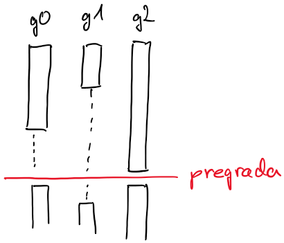
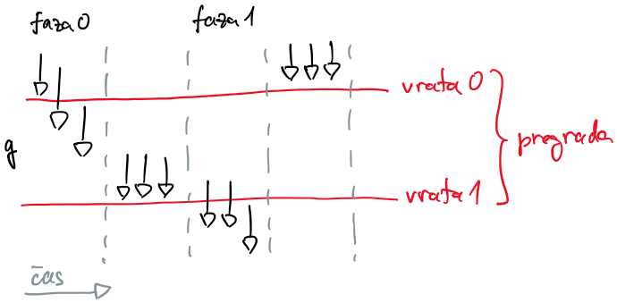
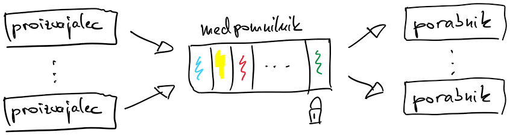

# Sinhronizacija

## Pogojne spremenljivke [SMAP:6.2]

- uporabimo jih, kadar mora gorutina v kritičnem odseku počakati, da bo izpolnjen pogoj za nadaljevanje
  - kritični odsek ščiti ključavnica, ki je povezana s pogojno spremenljivko
  - gorutina, ki pogoj spremeni, s pogojno spremenljivko zbudi čakajoče gorutine

- delovanje

  - gorutina najprej zaklene ključavnico in preveri pogoj
  - če pogoj ni izpolnjen, pokliče `Wait`, ki ključavnico sprosti in gorutino uspava; gorutina se postavi na zadnje mesto v vrsti spečih gorutin (FIFO)
  - druga gorutina lahko zbudi speče gorutine
    - s `Signal` zbudimo samo eno spečo gorutino
    - z `Broadcast` zbudimo vse speče gorutine
  - zbujena gorutina ponovno zaklene ključavnico, šele nato se `Wait` vrne
  - pogoj je lahko medtem spremenila druga gorutina, zato ga mora zbujena gorutina ponovno preveriti; `Wait` zato vedno kličemo v zanki
    - pri knjižnici pthreads se nit lahko zbudi celo brez signala
  - na koncu mora gorutina ključavnico sprostiti

- pogojne spremenljivke ne hranijo vrednosti; gre za vrsto spečih gorutin, ki gredo v izvajanje ob signalu
  - signal, poslan takrat, ko nobena gorutina ne čaka, se izgubi
  - ali je pogoj izpolnjen, mora gorutina po zbujenju preveriti sama

- primer: pregrada (*angl.* barrier) [LBS:3.6]

  - želimo, da se na neki točki vse gorutine počakajo in potem skupaj nadaljujejo

    

  - rešimo lahko z `wg.Add()`, `wg.Done()` in `wg.Wait()`, vendar vsakič ustvarjamo gorutine

  - [pregrada-1.go](koda/pregrada-1.go)
    - osnutek, brez nadzora

  - [pregrada-2.go](koda/pregrada-2.go)
    - štejemo gorutine, ki so že izvedele operacije v zanki
    - do težave pride ob ničenju števca:
      - gorutina 0 postavi števec na 0, preden ga druga (počasnejša) gorutina prebere
      - preden gorutina 0 postavi števec na 0, lahko druga gorutina že izvede naslednjo iteracijo in poveča števec
      - program se obesi
    - če ne bi imeli več obhodov zanke in s tem večkratne rabe iste pregrade, bi bila rešitev sprejemljiva (z odstranjenim stavkom if za ničenje števca)

  - [pregrada-3a.go](koda/pregrada-3a.go)
    - pregrado si predstavljamo kot dvoja vrata
      - spremenljivki števec gorutin med vrati (`g`) in faza (`phase`), ki določa, katera vrata so odprta
      - vedno so odprta ena sama vrata (v fazi 0 vrata 0, v fazi 1 vrata 1)
      - gorutine se ustavljajo pred zaprtimi vrati
      - zaprta vrata odpre zadnja gorutina, ki pride do njih, in hkrati zapre do sedaj odprta vrata
      - vrata 1 se odprejo, ko so vse gorutine šle skozi vrata 0 (takrat se faza zamenja iz 0 v 1)
      - vrata 0 se odprejo, ko so vse gorutine šle skozi vrata 1 (takrat se faza zamenja iz 1 v 0)
      - jezik go ob klicu z zastavico `-race` zazna tvegana stanja - ena gorutina piše, druga bere

        

  - [pregrada-3b.go](koda/pregrada-3b.go)
    - podobna rešitev kot [pregrada-3a.go](koda/pregrada-3a.go), le da fazo v zanki beremo pod bralno-pisalno ključavnico (`RLock`)
    - tveganega stanja ni več, gorutine pa še vedno porabljajo procesor z vrtenjem v zanki

  - [pregrada-4.go](koda/pregrada-4.go)
    - podobna rešitev kot [pregrada-3b.go](koda/pregrada-3b.go), vendar gorutine namesto vrtenja v zanki čakajo, da se v kanalu pojavi sporočilo
    - rešitev s kanali je bolj elegantna: gorutina je blokirana, medtem ko čaka, da se v kanalu pojavi podatek
    - dva kanala, z enim nadziramo prihajanje gorutin k pregradi (vrata 0), z drugim odhajanje gorutin od pregrade (vrata 1)

  - [pregrada-5.go](koda/pregrada-5.go)
    - ustvarimo pogojno spremenljivko in jo povežemo s ključavnico
    - vse gorutine, razen zadnje, damo na čakanje
    - ko preštejemo zadnjo gorutino, postavimo števec na 0 in zbudimo ostale gorutine
    - `Wait` ne kličemo v zanki, ker se v jeziku go `Wait` vrne samo po `Signal` ali `Broadcast`; zanke `for g < goroutines` ne moremo uporabiti, ker zadnja gorutina števec postavi na 0

  - [pregrada-6.go](koda/pregrada-6.go)
    - gorutina si ob prihodu do pregrade zapomni stanje skupne zastavice `barrierFlag`
    - zadnja gorutina postavi števec na 0, obrne skupno zastavico in zbudi ostale gorutine
    - gorutine čakajo v zanki, dokler se zastavica ne obrne
    - zastavica se ne more obrniti dvakrat, preden jo čakajoča gorutina preveri

- primer: proizvajalci in porabniki (*angl.* producer-consumer) [LBS:4.1]

  - izmenjava podatkov med gorutinami preko medpomnilnika
  - proizvajalci pošiljajo podatke v medpomnilnik
  - porabniki podatke pobirajo iz medpomnilnika
  - proizvajalci in porabniki morajo usklajeno dostopati do medpomnilnika
    - proizvajalec ne sme dodajati podatkov v medpomnilnik, če je ta poln
    - porabnik ne sme jemati podatkov iz medpomnilnika, če je ta prazen

    

  - [proizvajalci-porabniki-1.go](koda/proizvajalci-porabniki-1.go)
    - ogrodje kode brez sinhronizacijskih elementov
    - medpomnilnik za enega ali več podatkov s števcem števila podatkov in dvema indeksoma za krožno vrsto

  - [proizvajalci-porabniki-2.go](koda/proizvajalci-porabniki-2.go)
    - za vzpostavitev zanesljive izmenjave potrebujemo
      - ključavnico
      - dve pogojni spremenljivki za uspavanje in zbujanje proizvajalcev in porabnikov
    - če je medpomnilnik poln, se proizvajalci ustavijo
    - če je medpomnilnik prazen, porabniki čakajo
    - proizvajalci signalizirajo porabnikom, da lahko poberejo podatke iz medpomnilnika
    - porabniki signalizirajo proizvajalcem, da je v medpomnilniku prostor in lahko proizvajajo
    - s pogojnimi spremenljivkami in ključavnico v bistvu naredimo kanal

  - [proizvajalci-porabniki-3.go](koda/proizvajalci-porabniki-3.go)
    - elegantna rešitev s kanalom
    - kapaciteta kanala 0 predstavlja neposredno predajo izdelka iz rok proizvajalca v roke porabnika; te opcije prejšnje rešitve ne podpirajo
    - z zapiranjem kanala elegantno sporočimo porabnikom, da lahko zaključijo
